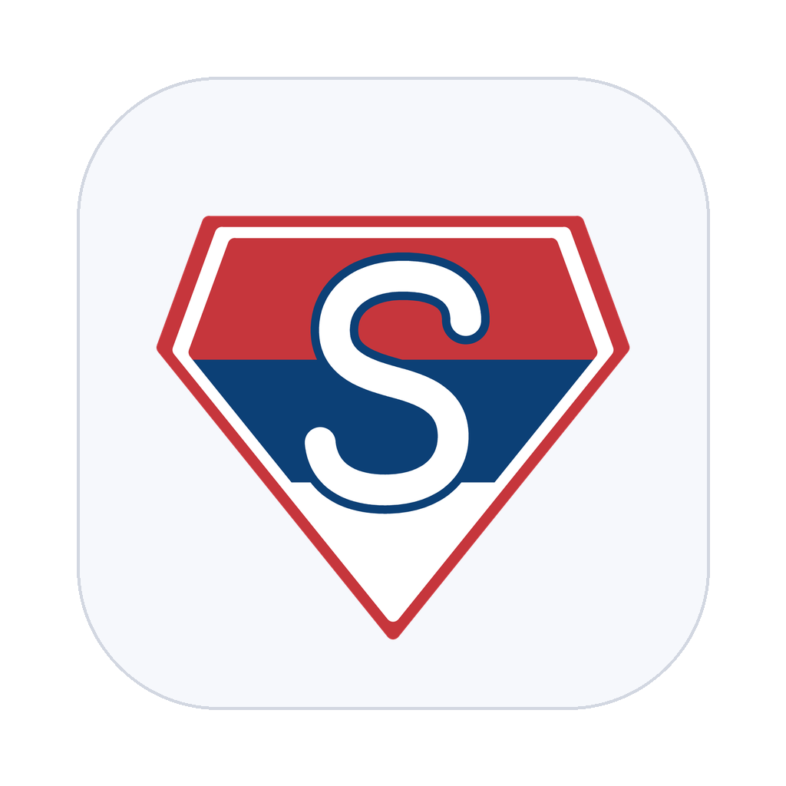

<b>English</b> · <a href="README.ru.md">Русский</a> · <a href="README.sr.md">Srpski</a>

# Super Čelik

One app instead of Čelik + TrustEdge ID for the Serbian electronic ID card, foreigner ID card and residence permit. Free, no account, no servers: card data never leaves your device.
Website: <https://celik.peregon.cc> · Privacy policy: [docs/PRIVACY.md](docs/PRIVACY.md) · Bugs and feedback: [GitHub Issues](https://github.com/peregond/SuperCelik/issues/new)

Languages: RU / EN / SR (Latin) / SR (Cyrillic). Serbian Cyrillic is produced from Serbian Latin by automatic transliteration (`scripts/translit_sr.py`, the same rules in Swift and C#).
Platforms: **iOS and iPadOS** (SwiftUI, reads through a USB-C reader, see [ios/README.md](ios/README.md)), **macOS** (SwiftUI, see [macos/README.md](macos/README.md)), **Android** (Kotlin + Jetpack Compose, Material You, see [android/README.md](android/README.md)), **Windows** (WPF, .NET 8) and **Linux** (**beta**, Avalonia, .NET 8, see [linux/README.md](linux/README.md)).
An independent implementation, not affiliated with MUP RS or NetSeT/Veridos.

## Install
- **iPhone and iPad**: [App Store](https://apps.apple.com/app/id6835244146).
- **macOS 13+**: the same app in the [Mac App Store](https://apps.apple.com/app/id6835244146). To build without the store, see “Build from source”.
- **Android 8+**: `SuperCelik-<version>-android.apk` from [Releases](https://github.com/peregond/SuperCelik/releases) (to install it by hand, allow installation from unknown sources). Reads the card through a USB smart-card reader (USB-C or OTG): data, MUP signature check, token, PIN change, file signing, eUprava sign-in.
- **Windows 10/11 x64**: `SuperCelik-<version>-windows-x64-setup.exe`. The installer is not signed with a publisher certificate, so SmartScreen may warn you (“More info” → “Run anyway”).
- **Linux (x64 and arm64), beta**: `SuperCelik-<version>-linux-amd64.deb` / `-arm64.deb` (Debian, Ubuntu and derivatives: `sudo apt install ./SuperCelik-*.deb`, which pulls in `pcscd`) or `SuperCelik-<version>-linux-<x64|arm64>.tar.gz` (unpack and run `./SuperCelik`; needs `pcscd` and `libpcsclite1`). Reads the card through a USB reader over PC/SC. It has not been tried on a real card under Linux yet: please report what you see in [Issues](https://github.com/peregond/SuperCelik/issues/new).

Builds are made automatically in GitHub Actions: every push to `main` → artifacts; a `vX.Y.Z` tag → a release.

## Build from source
macOS (Xcode 15+ / Swift 5.9):

    swift run                         # with a real reader
    SERBIAID_DEMO=1 swift run         # demo data, no card
    bash scripts/make-app.sh 0.9.9 arm64   # or x86_64 / universal → dist/*.dmg

Linux (.NET 8 SDK, `dpkg-deb` for the .deb):

    dotnet run --project linux/SerbiaID.Linux                      # with a real reader (needs pcscd)
    dotnet run --project linux/SerbiaID.Linux -- --demo            # demo data, no card
    bash scripts/make-linux.sh 0.9.9 x64                           # or arm64 → dist/*.deb and dist/*.tar.gz

Windows (.NET 8 SDK):

    dotnet build windows/SerbiaID.Windows -c Release
    windows\SerbiaID.Windows\bin\Release\net8.0-windows\SuperCelik.exe --selftest   # check on a real card, writes selftest.txt without personal data

## Status
- **Done on every platform:** interface in three languages, reader and ATR detection, reading personal data, address, document and photo, signature check (CMS + chain up to the MUP certificates from `Resources/CA`), reading the token certificate with chain validation, print / PDF.
- **Checked on a real card:** the Windows version (RP2024, `--selftest`): data, photo, both signatures and the token certificate chain. On macOS: PIN change, file signing and browser sign-in (see below). On iPhone: sign-in to eUprava through the system token (Safari) and the Home Screen quick actions.
- The protocol was obtained by observing `CelikApi.dll` and a real card; the fields were compared with the DLL's output. For the ID card (SERID) and the foreigner card (SERIF) the files are probably the same, but this is not verified; tags marked UNVERIFIED in the code are assumptions.
- **Token PIN:** “Change PIN”, “Unblock with PUK” and “Sign file” (detached CMS `.p7s`, SHA-256, token key 0x6005) are in the macOS, Windows, iOS and Android apps. **Not verified on a real token:** PIN change on Windows, iOS and Android, and **unblocking with PUK everywhere** (the APDU `00 2C 00 80` follows ISO 7816-4 and is not in public sources; a wrong PUK costs an attempt).
- **Browser sign-in with the card certificate (eid.gov.rs):** on **macOS** and **iOS** through the built-in card driver (CryptoTokenKit), verified on real cards. On **Android** the sign-in page opens inside the app with a card-backed key (checked in an emulator up to the signature call, not with a real card yet). On Windows and Linux the browser needs an official MUP / NetSeT driver or a PKCS#11 module (OpenSC or [srb-id-pkcs11](https://github.com/ubavic/srb-id-pkcs11)).
- **Linux is a beta:** built and tried in demo mode, not on a real card.
- Not done: the old Apollo card (protocol unknown).

## Sign-in on eid.gov.rs through Chrome / Safari (macOS)
Chrome and Safari on a Mac take client certificates only from the macOS keychain. The card gets there only through a system driver (CryptoTokenKit), and MUP / NetSeT have no driver for macOS, so the site used to say that no certificate was found even though Super Čelik read the card.

The driver is now inside the app (`SuperCelik.app/Contents/PlugIns/SuperCelikToken.appex`):
1. Install Super Čelik in Applications and run it once: it registers the driver and puts the MUP intermediate certificates into the “login” keychain (certificates only, trust is not changed).
2. Insert the card (if it was inserted before the installation, take it out and put it in again). To check in Terminal: `security list-smartcards` (a line `app.supercelik.token:SuperCelik-…` must appear) and `pluginkit -m -p com.apple.ctk-tokens`.
3. Quit Chrome completely (⌘Q, not just the window) and open the site again. This is required after every installation or update of the app and after inserting the card: if Chrome visited the site while the card was not in the system, it remembers “no certificate” and shows no choice until it is restarted. Chrome shows the certificate choice, and macOS asks for the PIN in a system window. A wrong PIN costs an attempt.

If the driver does not appear in `pluginkit -m -p com.apple.ctk-tokens`: `pluginkit -a /Applications/SuperCelik.app/Contents/PlugIns/SuperCelikToken.appex`, then take the card out and put it in. The driver log: `log show --last 10m --predicate 'subsystem == "app.supercelik.token"'`. Firefox can be set up without this, through the PKCS#11 module [srb-id-pkcs11](https://github.com/ubavic/srb-id-pkcs11).

## Security
Do not commit card dumps or any personal data (see `.gitignore`).
