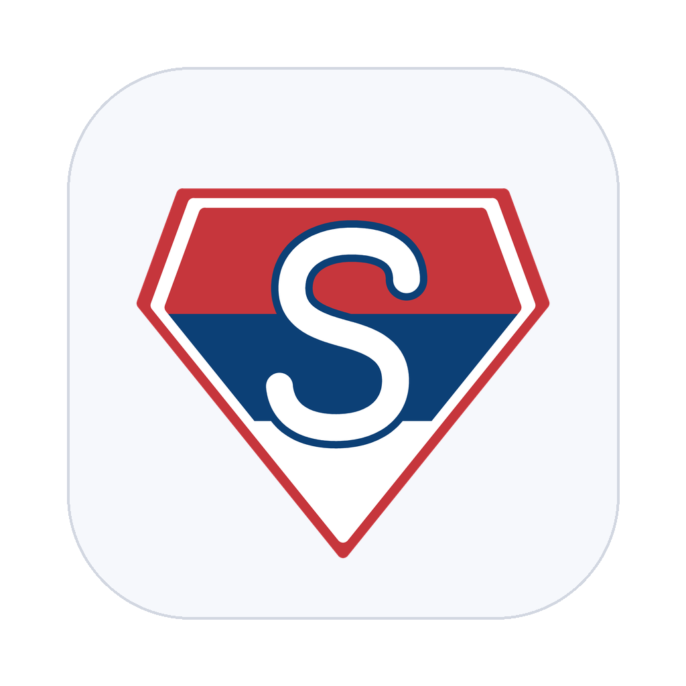

<a href="README.md">English</a> · <b>Русский</b> · <a href="README.sr.md">Srpski</a>

# Super Čelik

Единое приложение вместо Čelik + TrustEdge ID для сербской электронной ID-карты, карты иностранца и вида на жительство. В **тестовом режиме** читает также свидетельство о регистрации автомобиля (saobraćajna dozvola) и карту медицинского страхования (KZO). Бесплатно, без аккаунта и серверов: данные карты не покидают ваше устройство.
Сайт: <https://celik.peregon.cc> · Что нового: <https://celik.peregon.cc/changelog/> · Политика конфиденциальности: [docs/PRIVACY.md](docs/PRIVACY.md) · Ошибки и отзывы: [GitHub Issues](https://github.com/peregond/SuperCelik/issues/new)

Языки (10): русский, английский, сербский (латиница и кириллица), хорватский, венгерский, албанский, словацкий, румынский, украинский и белорусский. Сербская кириллица получается из сербской латиницы автоматической транслитерацией (`scripts/translit_sr.py`, те же правила в Swift и C#).
Платформы: **iOS и iPadOS** (SwiftUI, чтение через USB-C ридер, см. [ios/README.ru.md](ios/README.ru.md)), **macOS** (SwiftUI, см. [macos/README.ru.md](macos/README.ru.md)), **Android** (Kotlin + Jetpack Compose, Material You, см. [android/README.ru.md](android/README.ru.md)), **Windows** (WPF, .NET 8) и **Linux** (**бета**, Avalonia, .NET 8, см. [linux/README.ru.md](linux/README.ru.md)).
Независимая реализация, не связана с МУП РС и NetSeT/Veridos.

## Установка
- **iPhone и iPad**: [App Store](https://apps.apple.com/app/id6835244146).
- **macOS 12+**: то же приложение в [Mac App Store](https://apps.apple.com/app/id6835244146). Для сборки без магазина см. «Сборка вручную».
- **Android 8+**: `SuperCelik-<версия>-android.apk` из раздела [Releases](https://github.com/peregond/SuperCelik/releases) (для установки вручную разрешите установку из неизвестных источников). Читает карту через USB-ридер смарт-карт (USB-C или OTG): данные, проверка подписи МУП, токен, смена PIN, подпись файла, вход на eUprava.
- **Windows 10/11 x64**: `SuperCelik-<версия>-windows-x64-setup.exe`. Установщик не подписан сертификатом издателя: SmartScreen может показать предупреждение («Подробнее» → «Выполнить в любом случае»).
- **Windows XP SP3 / Vista / 7 и 32-разрядная Windows**: `SuperCelik-<версия>-windows-x86-legacy-setup.exe` (отдельная сборка на .NET Framework 4.0; установщик попросит его поставить, если его нет). Всё работает так же, кроме: драйвер для входа в браузере требует Windows Vista или новее (на XP его нет), а автообновление требует TLS 1.2 (Windows 7 с обновлениями; на XP нет). Собирается в CI, на настоящей XP пока не проверялась.
- **Linux (x64 и arm64), бета**: `SuperCelik-<версия>-linux-amd64.deb` / `-arm64.deb` (Debian, Ubuntu и производные: `sudo apt install ./SuperCelik-*.deb`, подтянет `pcscd`) или `SuperCelik-<версия>-linux-<x86_64|aarch64>.AppImage` (любой дистрибутив: `chmod +x` и запуск; в системе нужны `pcscd` и `libpcsclite1`) или `SuperCelik-<версия>-linux-<x86_64|aarch64>.flatpak` (`flatpak install --user ./SuperCelik-*.flatpak`; использует `pcscd` хоста через `--socket=pcsc`, нужен Flatpak 1.15.x или новее; модуля входа в браузер внутри песочницы нет) или `SuperCelik-<версия>-linux-<x64|arm64>.tar.gz` (распаковать и запустить `./SuperCelik`; нужны `pcscd` и `libpcsclite1`). Читает карту через USB-ридер по PC/SC; `.deb` сам ставит всё нужное (`pcscd`, драйвер ридера, утилиты NSS), а во всех сборках (кроме Flatpak) есть модуль для входа в браузере. На реальной карте под Linux пока не проверялось: пишите, что получилось, в [Issues](https://github.com/peregond/SuperCelik/issues/new).

Сборка делается автоматически в GitHub Actions: каждый push в `main` → артефакты; тег `vX.Y.Z` → релиз.

## Сборка вручную
macOS (Xcode 15+ / Swift 5.9):

    swift run                         # с реальным ридером
    SERBIAID_DEMO=1 swift run         # демо-данные без карты
    bash scripts/make-app.sh 0.9.9 arm64   # или x86_64 / universal → dist/*.dmg

Linux (.NET 8 SDK, `dpkg-deb` для .deb):

    dotnet run --project linux/SerbiaID.Linux                      # с реальным ридером (нужен pcscd)
    dotnet run --project linux/SerbiaID.Linux -- --demo            # демо-данные без карты
    bash scripts/make-linux.sh 0.9.9 x64                           # или arm64 → dist/*.deb, *.tar.gz, *.AppImage

Windows (.NET 8 SDK):

    dotnet build windows/SerbiaID.Windows -c Release
    windows\SerbiaID.Windows\bin\Release\net8.0-windows\SuperCelik.exe --selftest   # проверка на реальной карте, отчёт selftest.txt без личных данных

## Статус
- **Готово на всех платформах:** интерфейс на десяти языках, поиск ридеров и ATR, чтение личных данных, адреса, документа и фото, проверка подписи (CMS + цепочка до сертификатов МУП из `Resources/CA`), чтение сертификата токена с проверкой цепочки, печать / PDF.
- **Проверено на реальной карте:** Windows-версия (RP2024, `--selftest`): данные, фото, обе подписи и цепочка сертификатов токена. На macOS: смена PIN, подпись файла и вход в браузере (см. ниже). На iPhone: вход на eUprava через системный токен (Safari) и быстрые действия на главном экране.
- Протокол получен наблюдением за `CelikApi.dll` и реальной картой; поля сверены с выводом DLL. Для ID-карты (SERID) и карты иностранца (SERIF) файлы, вероятно, те же, но не проверено; теги с пометкой UNVERIFIED в коде — предположения.
- **PIN токена:** «Сменить PIN», «Разблокировать по PUK» и «Подписать файл» (отсоединённая подпись CMS `.p7s`, SHA-256, ключ токена 0x6005) есть в приложениях для macOS, Windows, iOS и Android. **На реальном токене не проверено:** смена PIN на Windows, iOS и Android, а также **разблокировка по PUK везде** (APDU `00 2C 00 80` взят по ISO 7816-4, в открытых источниках его нет; неверный PUK тратит попытку).
- **Вход в браузере по сертификату карты (eid.gov.rs):** на **macOS** и **iOS** через встроенный драйвер карты (CryptoTokenKit), проверено на реальных картах. На **Android** страница входа открывается внутри приложения с ключом, который опирается на карту (проверено на эмуляторе до вызова подписи, с настоящей картой ещё нет). На **Windows** приложение регистрирует собственный драйвер карты (один запрос прав администратора), и Chrome, Edge и Firefox берут сертификат из хранилища Windows. На **Linux** приложение подключает PKCS#11-модуль [srb-id-pkcs11](https://github.com/ubavic/srb-id-pkcs11) к Firefox, Chrome / Edge / Chromium ([linux/README.ru.md](linux/README.ru.md)). **Firefox** и **Edge** работают на всех трёх системах, см. разделы ниже.
- **Техпаспорт и медкарта (тестовый режим):** кнопка чтения на вкладке «Карта» сама определяет тип карты. Свидетельство о регистрации автомобиля разбирается по директиве ЕС 1999/37/EC и таблице полей из документации SDK МУП и **на настоящей карте ещё не проверено**: подпись издателя не проверяется, а имя приложения на чипе – неподтверждённое предположение; его можно сохранить в PDF и напечатать. Структура медкарты (KZO, РФЗО) получена разбором официальной программы чтения РФЗО ([docs/health-card-protocol.md](docs/health-card-protocol.md)) и тоже не проверена на настоящей карте: PIN не нужен, подписи не проверяются, печати пока нет. На iPhone и iPad обе карты читаются только через USB-ридер. Скрытая диагностика (Настройки: 5 нажатий на номер версии; `--diag` в Windows и Linux) записывает структуру настоящей карты без персональных данных. См. [docs/cards-research.md](docs/cards-research.md).
- **Linux в бета-статусе:** собрано и проверено в демо-режиме, на реальной карте нет.
- Не готово: старая карта Apollo (протокол неизвестен).

## Вход на eid.gov.rs через Chrome / Edge / Safari (macOS)
Chrome, Edge и Safari на Mac берут клиентские сертификаты только из связки ключей macOS. Карта попадает туда только через системный драйвер (CryptoTokenKit), а у MUP / NetSeT драйвера для macOS нет, поэтому раньше сайт писал, что сертификат не найден, хотя Super Čelik карту читал.

Теперь драйвер лежит внутри приложения (`SuperCelik.app/Contents/PlugIns/SuperCelikToken.appex`):
1. Установите Super Čelik в «Программы» и запустите его один раз: приложение регистрирует драйвер и кладёт промежуточные сертификаты МУП в связку ключей «Вход» (только сертификаты, доверие не меняется).
2. Вставьте карту (если была вставлена до установки, выньте и вставьте снова). Проверка в Терминале: `security list-smartcards` (должна появиться строка `app.supercelik.token:SuperCelik-…`) и `pluginkit -m -p com.apple.ctk-tokens`.
3. Полностью закройте Chrome или Edge (⌘Q, не только окно) и откройте сайт снова. Это обязательно после каждой установки или обновления приложения и после вставки карты: если браузер обращался к сайту, пока карты в системе не было, он запоминает «сертификата нет» и не показывает выбор, пока его не перезапустить. Браузер покажет выбор сертификата, а PIN попросит сама macOS в системном окне. Неверный PIN тратит попытку.

Если драйвер не появился в `pluginkit -m -p com.apple.ctk-tokens`: `pluginkit -a /Applications/SuperCelik.app/Contents/PlugIns/SuperCelikToken.appex`, затем вытащить и вставить карту. Журнал драйвера: `log show --last 10m --predicate 'subsystem == "app.supercelik.token"'`. Firefox: см. следующий раздел.

## Firefox
На Windows и macOS Firefox берёт клиентские сертификаты из системы, а на Linux из модуля PKCS#11:
- **Windows и macOS** (Firefox 90 и новее): из системы (хранилище сертификатов Windows, связка ключей на Mac), куда драйвер карты Super Čelik кладёт сертификат карты. В Firefox ничего ставить не нужно: полностью закройте его и откройте сайт снова. Если в профиле выключена настройка `security.osclientcerts.autoload` (`about:config`), приложение это заметит и предложит включить её (добавит одну строку в `user.js` этого профиля; сборка из Mac App Store не может трогать файлы Firefox, там переключатель в `about:config` включается вручную).
- **Linux:** системного хранилища нет, поэтому после вашего согласия приложение подключает свой PKCS#11-модуль ко всем найденным профилям Firefox: `~/.mozilla/firefox` и `~/.config/mozilla/firefox` (там Firefox 147 и новее держит новые профили), а также профилям, которые `profiles.ini` указывает в других местах. Профиль, появившийся позже, подключается автоматически. Firefox из **Snap** (по умолчанию в Ubuntu) или **Flatpak** работает в изолированной среде, которая не пускает к нему модуль (Ubuntu описывает ручную настройку для Snap-браузеров, но называет её экспериментальной), поэтому приложение его не трогает: поставьте Firefox обычным пакетом ([инструкция Mozilla](https://support.mozilla.org/kb/install-firefox-linux)) или входите через Chrome / Edge. Подробности и требования: [linux/README.ru.md](linux/README.ru.md).

## Edge
Microsoft Edge построен на Chromium и входит так же, как Chrome:
- **Windows и macOS:** из системы (хранилище сертификатов Windows, связка ключей на Mac), куда драйвер карты Super Čelik кладёт сертификат карты. В Edge ничего ставить не нужно: полностью закройте его и откройте сайт снова.
- **Linux:** Edge использует одну общую базу NSS вместе с Chrome, Chromium и Brave, поэтому одной регистрации хватает им всем: после вашего согласия приложение подключает к ней свой PKCS#11-модуль. База лежит в `~/.pki/nssdb`; Chromium 146 и новее (Edge идёт за ним) используют `~/.local/share/pki/nssdb`, если старой базы нет. Приложение подключает модуль к каждой существующей копии, а если их нет и один из этих браузеров установлен, создаёт `~/.pki/nssdb`. Edge из Flatpak работает в изолированной среде и остаётся нетронутым, как Firefox из Snap. Подробности: [linux/README.ru.md](linux/README.ru.md).

## Если браузер не предлагает карту
Полностью закройте браузер (все окна; на Mac ⌘Q) и откройте страницу входа заново. Если не помогло, выньте карту из ридера и вставьте снова. В **macOS** и **Linux** кнопка «Проверить вход в браузере» рядом с «Войти на eUprava» показывает, что не так (ридер и карта, драйвер карты на Mac или модуль в Linux, Firefox), и подсказывает, что делать; в **Windows** состояние драйвера и Firefox видно на вкладке «Настройки».

## Один номер версии
У всех платформ одна версия: git-тег `vX.Y.Z` релиза. Сборки Windows, Linux, macOS и Android и тестовая сборка iOS берут её из тега, а два App Store-workflow (iOS и macOS) по умолчанию берут последний тег релиза, так что номер в магазинах совпадает с номером на GitHub. Каждое обновление получает новый тег. Чтобы выпустить: запишите изменения релиза в блок `site/changelog/index.html` с новым номером и датой (блок «Следующий релиз» переименовывается), влейте это, затем создайте тег. Номер сборки Android считается из версии (1.3.2 даёт 10302), номер сборки App Store это номер запуска workflow.

## Безопасность
Не коммитьте дампы карты и любые личные данные (см. `.gitignore`).
