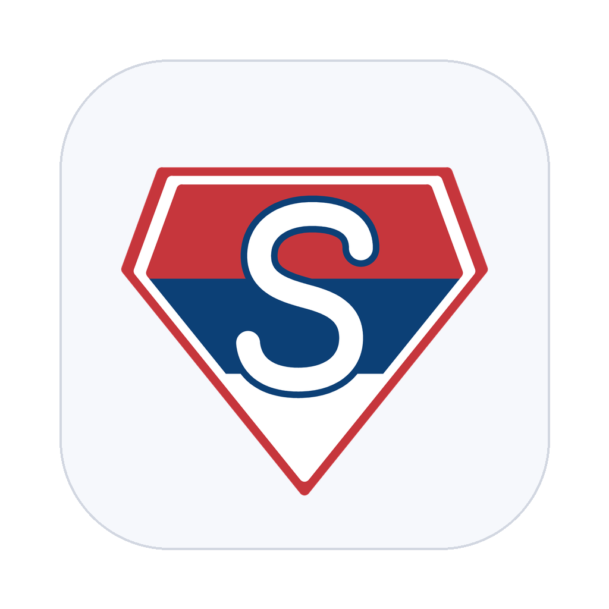

<a href="README.md">English</a> · <a href="README.ru.md">Русский</a> · <b>Srpski</b>

# Super Čelik

Jedna aplikacija umesto Čelik + TrustEdge ID za srpsku elektronsku ličnu kartu, ličnu kartu za strance i boravišnu dozvolu. Besplatno, bez naloga i servera: podaci sa kartice ne napuštaju vaš uređaj.
Sajt: <https://celik.peregon.cc> · Politika privatnosti: [docs/PRIVACY.md](docs/PRIVACY.md) · Greške i povratne informacije: [GitHub Issues](https://github.com/peregond/SuperCelik/issues/new)

Jezici: RU / EN / SR (latinica) / SR (ćirilica). Srpska ćirilica se dobija iz srpske latinice automatskom transliteracijom (`scripts/translit_sr.py`, ista pravila u Swift-u i C#-u).
Platforme: **iOS i iPadOS** (SwiftUI, čitanje preko USB-C čitača, vidi [ios/README.sr.md](ios/README.sr.md)), **macOS** (SwiftUI, vidi [macos/README.sr.md](macos/README.sr.md)), **Android** (Kotlin + Jetpack Compose, Material You, vidi [android/README.sr.md](android/README.sr.md)), **Windows** (WPF, .NET 8) i **Linux** (**beta**, Avalonia, .NET 8, vidi [linux/README.sr.md](linux/README.sr.md)).
Nezavisna implementacija, nije povezana sa MUP RS niti sa NetSeT/Veridos.

## Instalacija
- **iPhone i iPad**: [App Store](https://apps.apple.com/app/id6835244146).
- **macOS 13+**: ista aplikacija u [Mac App Store](https://apps.apple.com/app/id6835244146). Za gradnju bez prodavnice vidi „Gradnja iz izvornog koda“.
- **Android 8+**: `SuperCelik-<verzija>-android.apk` iz odeljka [Releases](https://github.com/peregond/SuperCelik/releases) (za ručnu instalaciju dozvolite instalaciju iz nepoznatih izvora). Čita karticu preko USB čitača pametnih kartica (USB-C ili OTG): podaci, provera MUP potpisa, token, promena PIN-a, potpisivanje fajla, prijava na eUprava.
- **Windows 10/11 x64**: `SuperCelik-<verzija>-windows-x64-setup.exe`. Instalater nije potpisan sertifikatom izdavača, pa SmartScreen može da prikaže upozorenje („More info“ → „Run anyway“).
- **Windows XP SP3 / Vista / 7 i 32-bitni Windows**: `SuperCelik-<verzija>-windows-x86-legacy-setup.exe` (posebna verzija na .NET Framework 4.0; instalater traži da ga instalirate ako ga nema). Sve radi isto, osim: drajver za prijavu u pregledaču zahteva Windows Vista ili noviji (na XP-u ga nema), a automatsko ažuriranje zahteva TLS 1.2 (Windows 7 sa ažuriranjima; na XP-u ne). Pravi se u CI-ju, na pravom XP-u još nije probana.
- **Linux (x64 i arm64), beta**: `SuperCelik-<verzija>-linux-amd64.deb` / `-arm64.deb` (Debian, Ubuntu i izvedene distribucije: `sudo apt install ./SuperCelik-*.deb`, povući će `pcscd`) ili `SuperCelik-<verzija>-linux-<x86_64|aarch64>.AppImage` (bilo koja distribucija: `chmod +x` i pokretanje; u sistemu su potrebni `pcscd` i `libpcsclite1`) ili `SuperCelik-<verzija>-linux-<x86_64|aarch64>.flatpak` (`flatpak install --user ./SuperCelik-*.flatpak`; koristi `pcscd` domaćina preko `--socket=pcsc`, potreban je Flatpak 1.15.x ili noviji; modula za prijavu u pregledaču unutar sandbox-a nema) ili `SuperCelik-<verzija>-linux-<x64|arm64>.tar.gz` (raspakujte i pokrenite `./SuperCelik`; potrebni su `pcscd` i `libpcsclite1`). Čita karticu preko USB čitača putem PC/SC; `.deb` sam instalira sve potrebno (`pcscd`, drajver čitača, NSS alate), a gradnje za x64 sadrže modul za prijavu u pregledaču. Na pravoj kartici pod Linux-om još nije proverena: javite šta ste videli u [Issues](https://github.com/peregond/SuperCelik/issues/new).

Gradnja se automatski radi u GitHub Actions: svaki push na `main` → artefakti; tag `vX.Y.Z` → izdanje.

## Gradnja iz izvornog koda
macOS (Xcode 15+ / Swift 5.9):

    swift run                         # sa pravim čitačem
    SERBIAID_DEMO=1 swift run         # demo podaci bez kartice
    bash scripts/make-app.sh 0.9.9 arm64   # ili x86_64 / universal → dist/*.dmg

Linux (.NET 8 SDK, `dpkg-deb` za .deb):

    dotnet run --project linux/SerbiaID.Linux                      # sa pravim čitačem (potreban pcscd)
    dotnet run --project linux/SerbiaID.Linux -- --demo            # demo podaci bez kartice
    bash scripts/make-linux.sh 0.9.9 x64                           # ili arm64 → dist/*.deb, *.tar.gz, *.AppImage

Windows (.NET 8 SDK):

    dotnet build windows/SerbiaID.Windows -c Release
    windows\SerbiaID.Windows\bin\Release\net8.0-windows\SuperCelik.exe --selftest   # provera na pravoj kartici, izveštaj selftest.txt bez ličnih podataka

## Status
- **Gotovo na svim platformama:** interfejs na tri jezika, pronalaženje čitača i ATR-a, čitanje ličnih podataka, adrese, dokumenta i fotografije, provera potpisa (CMS + lanac do MUP sertifikata iz `Resources/CA`), čitanje sertifikata tokena sa proverom lanca, štampa / PDF.
- **Provereno na pravoj kartici:** Windows verzija (RP2024, `--selftest`): podaci, fotografija, oba potpisa i lanac sertifikata tokena. Na macOS-u: promena PIN-a, potpisivanje fajla i prijava u pregledaču (vidi dole). Na iPhone-u: prijava na eUprava preko sistemskog tokena (Safari) i brze radnje na početnom ekranu.
- Protokol je dobijen posmatranjem `CelikApi.dll` i prave kartice; polja su uporedena sa izlazom DLL-a. Za ličnu kartu (SERID) i karticu za strance (SERIF) fajlovi su verovatno isti, ali nije provereno; oznake UNVERIFIED u kodu su pretpostavke.
- **PIN tokena:** „Promeni PIN“, „Otključaj preko PUK-a“ i „Potpiši fajl“ (odvojeni CMS potpis `.p7s`, SHA-256, ključ tokena 0x6005) postoje u aplikacijama za macOS, Windows, iOS i Android. **Na pravom tokenu nije provereno:** promena PIN-a na Windows-u, iOS-u i Android-u, kao i **otključavanje preko PUK-a svuda** (APDU `00 2C 00 80` je uzet iz ISO 7816-4, u javnim izvorima ga nema; pogrešan PUK troši pokušaj).
- **Prijava u pregledaču sertifikatom sa kartice (eid.gov.rs):** na **macOS-u** i **iOS-u** preko ugrađenog drajvera kartice (CryptoTokenKit), provereno na pravim karticama. Na **Androidu** se stranica za prijavu otvara unutar aplikacije sa ključem koji se oslanja na karticu (provereno na emulatoru do poziva potpisa, sa pravom karticom još ne). Na Windows-u i Linux-u pregledaču treba zvanični MUP / NetSeT drajver ili PKCS#11 modul (OpenSC ili [srb-id-pkcs11](https://github.com/ubavic/srb-id-pkcs11)).
- **Linux je u beta statusu:** izgrađen i isproban u demo režimu, ne na pravoj kartici.
- Nije gotovo: stara kartica Apollo (protokol nepoznat).

## Prijava na eid.gov.rs preko Chrome-a / Safari-ja (macOS)
Chrome i Safari na Mac-u uzimaju klijentske sertifikate samo iz macOS lanca ključeva (keychain). Kartica tamo dospeva samo preko sistemskog drajvera (CryptoTokenKit), a MUP / NetSeT nemaju drajver za macOS, pa je sajt ranije pisao da sertifikat nije pronađen, iako je Super Čelik čitao karticu.

Drajver je sada unutar aplikacije (`SuperCelik.app/Contents/PlugIns/SuperCelikToken.appex`):
1. Instalirajte Super Čelik u „Applications“ i pokrenite ga jednom: aplikacija registruje drajver i stavlja MUP posredničke sertifikate u keychain „login“ (samo sertifikate, poverenje se ne menja).
2. Ubacite karticu (ako je bila ubačena pre instalacije, izvadite je i ubacite ponovo). Provera u Terminalu: `security list-smartcards` (mora se pojaviti red `app.supercelik.token:SuperCelik-…`) i `pluginkit -m -p com.apple.ctk-tokens`.
3. Potpuno zatvorite Chrome (⌘Q, ne samo prozor) i ponovo otvorite sajt. Ovo je obavezno posle svake instalacije ili ažuriranja aplikacije i posle ubacivanja kartice: ako je Chrome pristupio sajtu dok kartice nije bilo u sistemu, pamti „nema sertifikata“ i ne prikazuje izbor dok se ne restartuje. Chrome prikazuje izbor sertifikata, a PIN traži sam macOS u sistemskom prozoru. Pogrešan PIN troši pokušaj.

Ako se drajver ne pojavi u `pluginkit -m -p com.apple.ctk-tokens`: `pluginkit -a /Applications/SuperCelik.app/Contents/PlugIns/SuperCelikToken.appex`, pa izvadite i ubacite karticu. Dnevnik drajvera: `log show --last 10m --predicate 'subsystem == "app.supercelik.token"'`. Firefox se može podesiti i bez ovoga, preko PKCS#11 modula [srb-id-pkcs11](https://github.com/ubavic/srb-id-pkcs11).

## Bezbednost
Ne komitujte dumpove kartice ni bilo kakve lične podatke (vidi `.gitignore`).
